# Agentic Pipeline for Onchain Data Analysis

This Agentic pipeline automates SQL query development, with optional support for ingesting external data from APIs to load custom datasets in Dune. The agent is designed for Claude Code's CLI. It provides a standardized workflow for generating and testing queries in Dune using AI, managing files, and maintaining version control through Github.

The original pipeline was used by the research team at Blocmates. This version recreates the workflow without Blocmates' company data. 

## Features

- **Automated DuneSQL development:** Generate, test, and publish DuneSQL queries from a data specification using reusable skills for blockchain data and external APIs.
- **External API integration:** Combine blockchain data with external API data using Dune LiveFetch or Python scripts to create custom datasets in Dune.
- **Scheduled dataset refreshes:** Use GitHub Actions to run Python ingestion scripts on a schedule and update datasets created from external APIs.
- **GitHub version control:** Store SQL queries in GitHub, synchronize changes from Dune, and open pull requests for team review. Use the repository's version history to restore previous query versions.

## How it works

The pipeline starts with a data specification definining the desired visualizations. When the user invokes the `/run-spec` command in Claude Code, the agent selects the relevant skill files and Python scripts based on the blockchains and APIs referenced in the dataspec. 

The agent generates and tests SQL queries, and calls external APIs when required. Generated queries are published to the user's Dune account and daved as `.sql` files on Github for review and version control. Users can inspect the queries in Dune and request changes in Claude Code that appear in real-time. 

Dashboard visualizations must be configured manually in Dune's interface. 

The workflow is pre-loaded with context for the Solana blockchain and the DeFiLlama API. To generate queries with data from other blockchains and APIs you must first create additional context files. see the {insert} section. 



## Example Dashboards

The following dashboards were created with the original pipeline at Blocmates:
- [MetaDAO Blocmates Pro](https://dune.com/blocmates_research/metadao-blocmates-pro): MetaDAO ICO analytics covering commitments, final raises, oversubscription, contributors, and raise progress.
- [Chain GDP](https://dune.com/blocmatesresearch/chain-gdp): Cross-chain analysis of chain GDP over time and GDP by protocol category.


## Prerequisites

### Local setup

- Git
- Python 3 with `pip` and `venv`

### Full pipeline execution

- A Dune account with API access and sufficient credits for query execution
- [Claude Code](https://claude.com/claude-code) installed and configured with a supported model provider
- GitHub CLI (`gh`) and repository write permissions for automated Git operations and pull requests

### Costs

| Service     | Tier    | Cost       |
| ----------- | ------- | ---------- |
| Dune        | Analyst | $75/mo     |
| GitHub      | Free    | $0         |
| Claude Code | Pro     | $17/mo     |
| **Total**   |         | **$92/mo** |

Consult the providers' current documentation for subscription costs, model authentication, and API availability.

## Setup

The following instructions use a Linux or macOS terminal.

### 1. Clone the repository

```bash
git clone https://github.com/DeFi-Kai/dune-etl-agent.git
cd dune-etl-agent
```

### 2. Install Python dependencies

Create and activate a virtual environment:

```bash
python3 -m venv .venv
source .venv/bin/activate
```

Install the dependencies:

```bash
python -m pip install -r scripts/requirements.txt
```

### 3. Configure environment variables (Dune and other APIs)

Copy the example environment file:

```bash
cp .env.example .env
```

The example file contains:

```dotenv
DUNE_API_KEY=replace_with_your_dune_api_key
```

To execute queries or synchronize files through Dune's API, obtain a key from [Dune API Settings](https://dune.com/settings/api) and replace the placeholder value in `.env`.

Add any credentials required by external APIs used in your data specifications.

**Security:** Never commit `.env` or API credentials to version control. Only `.env.example`, containing placeholder values, should be tracked.

If you do not have Dune API access, you can still install the dependencies and run local static checks. Live query execution and API synchronization will not be available.

### 4. Configure Claude Code

Install [Claude Code](https://claude.com/claude-code) and configure a supported authentication method or model provider.

Open a terminal in the repository directory and start Claude Code:

```bash
claude
```

The `.claude/` directory contains the agent instructions, commands, and skills used by the workflow.

Claude Code must have access to a working model before you can invoke the agent workflow. 

### 6. Authenticate with GitHub (for `gh pr create` and `git push`)

   Create a **fine-grained PAT** at https://github.com/settings/personal-access-tokens — scoped to *only* the repository you intend to push to, so the blast radius is contained if it leaks.

   If you don't have write access to this repository, fork it to your GitHub account first.

   - **Repository access:** *Only select repositories* → select your repository
   - **Expiration:** 90 days (forces rotation)
   - **Repository permissions:**
     - `Contents`: Read and write — for `git push` / `git pull`
     - `Pull requests`: Read and write — for `gh pr create`
     - `Workflows`: Read and write — only if the agent should edit `.github/workflows/*.yml`
     - `Metadata`: Read (auto-included)

   Leave everything else off. No account permissions, no other repositories.

   Then authenticate `gh` with the token:

   ```bash
   gh auth login
   # → GitHub.com
   # → HTTPS
   # → Paste an authentication token
   # → Paste your PAT
   ```

   Verify authentication:

   ```bash
   gh auth status
   ```

   GitHub CLI can configure Git authentication for HTTPS operations, allowing `git push` without repeating the login process.

## Usage

### 1. Create a data specification

Create a Markdown file under `context/` describing the dataset or dashboard you want to build.

Use `examples/data_spec_example.md` as a template.

The specification identifies:

- Target blockchains
- External APIs, if applicable
- Desired queries and visualizations
- Data refresh requirements

The `context/` directory is excluded from version control so project-specific specifications and working notes remain local.

### 2. Run the agent

Open Claude Code in the repository directory and invoke:

```text
/run-spec context/<project>.md
```

Replace `<project>.md` with your specification's filename.

The agent reads the specification, loads the relevant skills and reference files, and generates DuneSQL queries.

### 3. Verify and publish queries

The workflow uses `verify.py` for SQL checks and Dune API operations for live execution.

Generated queries are stored as `.sql` files for version control and inspection. The workflow can synchronize queries with Dune using the provided scripts.

The final queries can be opened in Dune's interface for manual verification and visualization configuration.

Live execution, synchronization, and the complete `/run-spec` workflow require the external services described in the prerequisites.

## Extending the Agent

The repository organizes domain knowledge into reusable skills.

Shared skills contain general instructions, while leaf skills provide chain-specific or API-specific references.

Existing examples include:

- `chain-solana`: Solana tables, schemas, and query guidance
- `api-defillama`: DefiLlama endpoints and API guidance

To add support for another blockchain or API:

1. Create a corresponding skill directory and `SKILL.md` file, following the structure of an existing leaf.
2. Document the relevant tables or endpoints, authentication requirements, rate limits, and implementation considerations.
3. Reference the new skill through the `chains` or `apis` fields in your data specification.
4. Restart Claude Code or reload the skills so the new reference can be discovered.

Use the existing implementations as examples when defining additional skills.
The existing leaves (`chain-solana/SKILL.md`, `api-defillama/SKILL.md`) are the reference implementations — mirror their structure for consistency.

